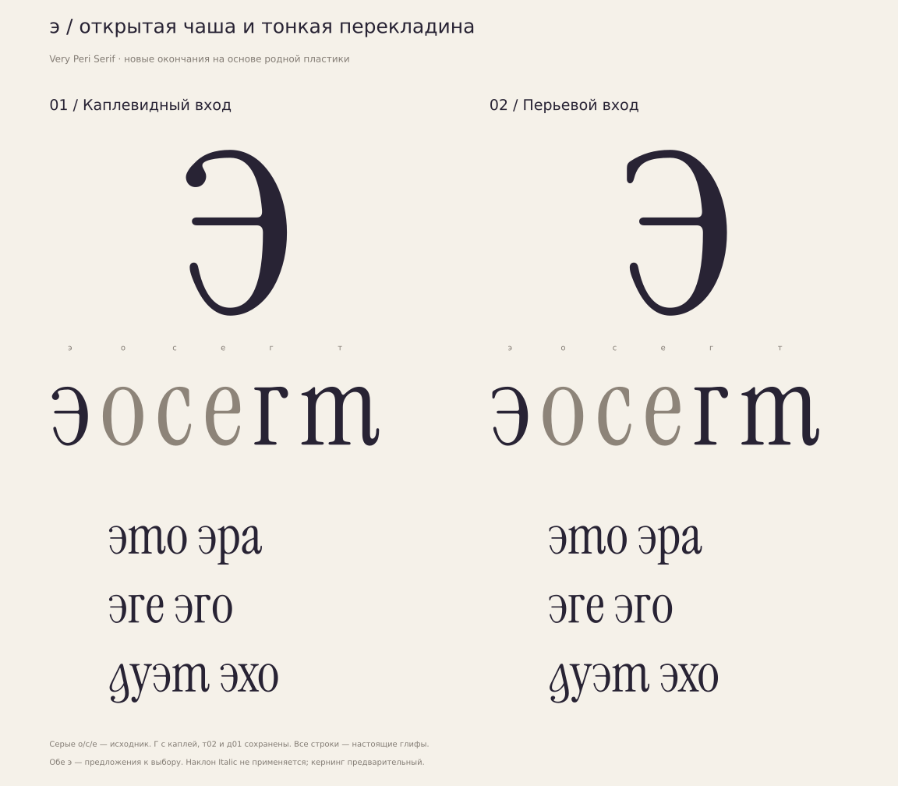

# э — открытая чаша и тонкая перекладина

**[ОТКРЫТО · 15.10.2026]** Два варианта строчной э в прямом Regular.
Основная ещё не выбрана.



| Вариант | Вход и апертура | Пробные файлы |
|---|---|---|
| 01 «Каплевидный вход» | Небольшая направленная капля, более длинная перекладина | [TTF](ereversed-01.ttf), [WOFF2](ereversed-01.woff2), [Glyphs](ereversed-01.glyphs), [SVG](ereversed-01.svg) |
| 02 «Перьевой вход» | Короткое сухое окончание, более открытый верх и укороченная перекладина | [TTF](ereversed-02.ttf), [WOFF2](ereversed-02.woff2), [Glyphs](ereversed-02.glyphs), [SVG](ereversed-02.svg) |

**[РЕШЕНИЕ]** Г с каплей повторно подтверждена пользователем как основная;
клюв остаётся через ss05. Выбранные д01 и т02, альтернативы и исходная латиница
сохраняются точно. По две э с каждой из четырёх комбинаций к/й; их выбор открыт.
Обе э доступны отдельными пробными шрифтами, нового ss-переключателя нет.

**[НАБЛЮДЕНИЕ]** Письменный скелет: верхний левый вход поднимается в свод,
непрерывный правый штрих спускается к основанию и истончается в нижнем левом
выходе. Тонкая перекладина возвращается влево от правой стороны.
У буквы одна чаша без талии з; оба просвета открыты слева.
Эта интерпретация движения не выдаётся за документированный метод автора
Instrument Serif. Контуры c целиком не отражаются.

**[ИЗМЕРЕНО]** Правая наружная половина o и внутренняя нижняя четверть
сохранены со сдвигом `(-40,0)`. Внутренний верх точно разделён по de Casteljau
на y325 для нового подвода к перекладине. Левые окончания и сопряжения
нарисованы заново. У01 верхняя капля родственна r/f; у02 короткая шпора
родственна направленным окончаниям c/s. Кончик02 округлён, не заострён.

Advance368. Правая граница343, правое поле25; верх516, низ−9.
Правый бок76, корона/низ25 в сохранённых частях o.
Перекладина y277–302, толщина25 — как у e. Её свободный край x42/65;
верхние открытые просветы96/108, нижний118 — вертикальные bounds-разности,
не нормальные толщины. Кубических узлов59/57; один замкнутый контур у каждой.

Источник и описание движения:
[ereversed-outlines.json](../../../data/ereversed-outlines.json).
Локальная подгонка целочисленного TTF (≤1 единицы на координату):
[ereversed-export.json](../../../data/ereversed-export.json). Кубический исходник
не меняется; узлы не добавляются. Все явные сопряжения TTF имеют точную общую
касательную.
Измерения: [metrics.json](metrics.json).
Проверка исходника, целочисленного экспорта, топологии и отклонения:
[outline-audit.json](outline-audit.json).
Размерные контурные пробы [12/24/100pt на светлом и тёмном](sizes.svg).
В строках используются только существующие глифы текущей сборки, без fallback.

**[ОТКРЫТО]** Кернинг справа начинает с o: правый край и поле соответствуют
донору. Для открытого левого края нет назначенного латинского донора;
входящие кириллические пары и окончательные интервалы требуют настройки.
Якоря `(164,510)` и `(164,0)` следуют o со сдвигом−40x.
Техническая чистота не означает утверждение стиля.

Воспроизведение с requirements-fonts.txt:

```bash
python3 tools/prepare_reference.py
python3 tools/build_ereversed.py
```

Выход создаётся в игнорируемой build/regular/ereversed.
FontBakery/Hyperglot не запускались. Полного набора и финального кернинга нет.

Источник: Instrument/instrument-serif,
`65c0ef225f386a3c7e87570a4aa9cc0262c2fd81`, Regular m01, UPM1000.
Производные пробы под [SIL OFL1.1](OFL.txt).
