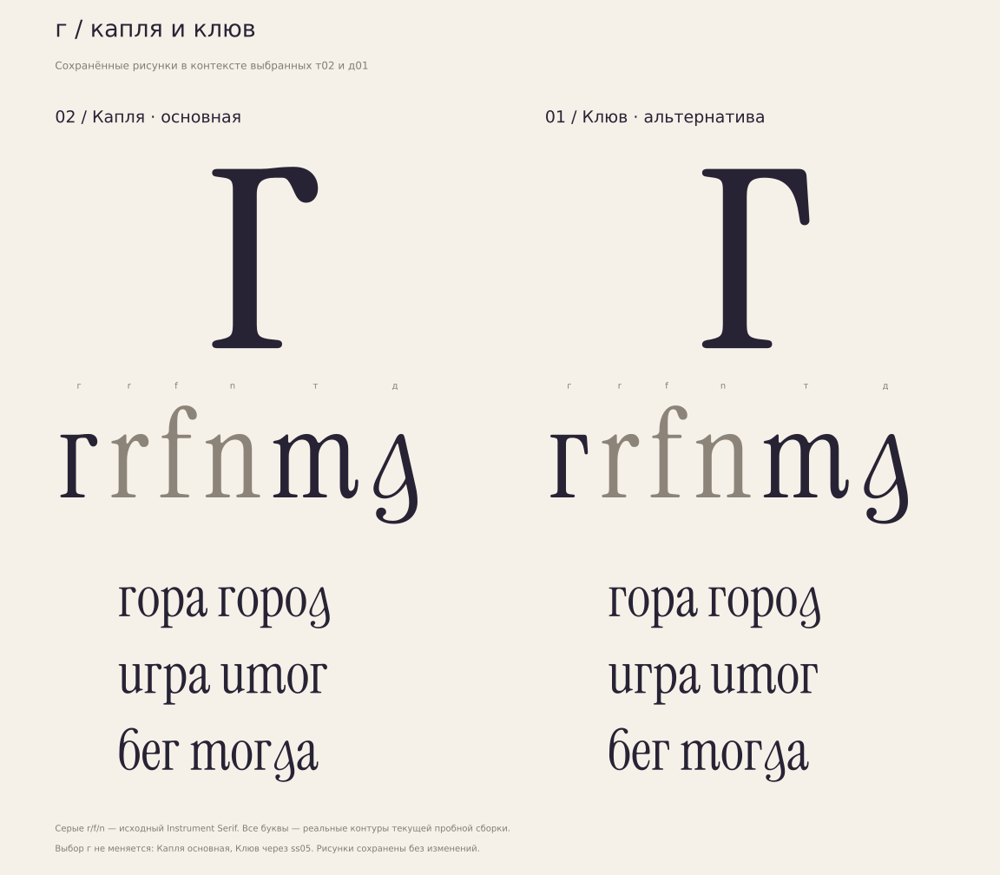

# г рядом с выбранными т02 и д01

**[РЕШЕНИЕ · 15.10.2026]** Для ответа на вопрос о г показаны сохранённые
рисунки:02 «Капля» — основная,01 «Клюв» — альтернатива через ss05.
Контуры шрифта не изменены. Т02 «Письменный выход» теперь выбрана основной,
т01 «Родные арки» — альтернативным стилем; д01 сохранена точно.



**[НАБЛЮДЕНИЕ]** Верхняя капля связывает г с окончаниями r/f,
вертикальная стойка и нижняя засечка — с n/r. Клюв даёт более острый верх.
В словах «гора», «город», «игра», «итог», «бег», «тогда» используются только
имеющиеся глифы сборки. Серые r/f/n — исходная латиница.

**[ИЗМЕРЕНО]** Лист набран из te-02.ttf. В основной г advance335,
в альтернативной339. HarfBuzz-позиции и SHA шрифта —
[shaping.json](shaping.json). Воспроизведение:

```bash
python3 tools/proof_ghe_context.py
```

Выход: игнорируемая build/ghe-context. Основные файлы и история г:
[ghe/](../README.md). Кернинг предварительный; FontBakery/Hyperglot
для этой презентации не запускались.
